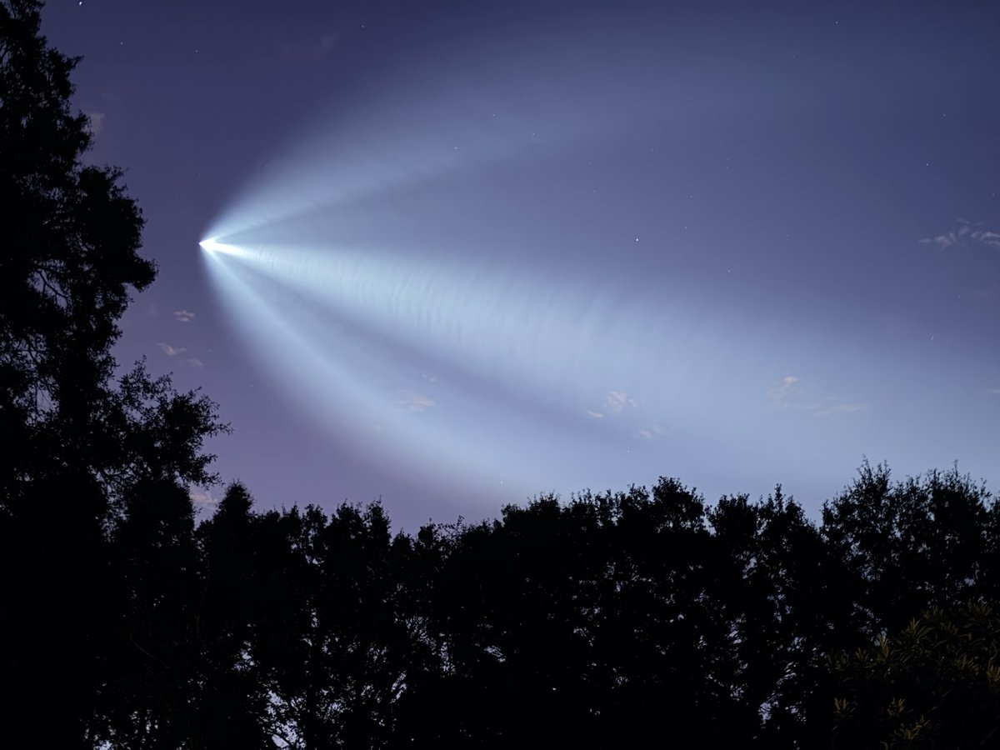
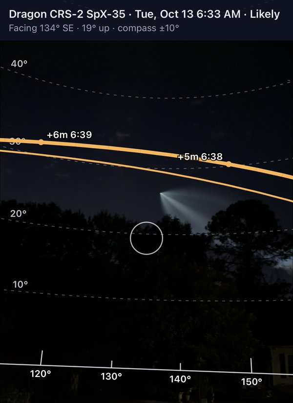

# Space Jellyfish

[](CHANGELOG.md)

<p align="center">
  
</p>

Hyperlocal predictor and email alerts for twilight "space jellyfish" launch
visibility from Charleston, SC.

**Live:** https://jellyfish.benneely.com · [What changed](CHANGELOG.md)

## What it is
A "space jellyfish" is the glowing plume that appears when a rocket climbs
high enough to be in sunlight while the observer on the ground is still in
twilight or darkness. We aim to predict when a launch from Cape Canaveral or Kennedy
Space Center will produce that effect as seen from Charleston, SC (James
Island, ZIP 29412), which our geometry code places 466 km (290 statute miles)
from Space Launch Complex 40.

The question is therefore not only "is there a launch, and is the sky clear?"
It is a question of illumination geometry: where the rocket is, where the Sun
is, and whether the plume is lit while Charleston is dark.

This is an independent build from public data sources: the Launch Library 2
API for launches and NOAA cloud forecasts through Open-Meteo. We take no code,
predictions, or images from other launch-visibility sites, although we have
read how they describe their methods (see `reference/`).

## Status
There is a live web page and a tested geometry engine, but there are no alerts
yet. The page shows a cloud forecast next to the verdict; the verdict itself
is still geometry only.
[PLAN.md](PLAN.md) holds the roadmap.

**The page.** `index.html` lists upcoming Cape Canaveral and Kennedy Space
Center launches and, for each one with a set time, shows whether a sunlit
plume is likely, the clock window in which to look, the compass direction it
moves through, how high it climbs, a chart of its path across the sky, and how
the answer changes if liftoff slips (ten-minute steps for two hours either
side). It refreshes launch times each time it is opened, at most once every 20
minutes. Launch Library 2 allows only 15 requests an hour from one address, so
the page asks from each visitor's own browser, and if that fails it shows
the last copy it has, with its date. (We tried a shared feed on Cloudflare;
Launch Library 2 rejected every request from Cloudflare's shared addresses,
so we removed it.)

**Clouds.** Within about 7 days of a launch, each card shows the forecast
cloud cover over the observer and at places between the observer and the
top of the rocket's arc, out to 60 km. The sight line climbs as it goes
out, so cloud farther away usually sits below it (at 10 degrees up, the line
is above 12 km of height by about 66 km out). The forecast is NOAA's
National Blend of Models (NBM) through Open-Meteo, and, within about a day
and a half, NOAA's HRRR low cloud as well. Each card also says how often
forecasts that far ahead were right at twilight. The cloud top height, the
spacing of the places, and how much of the arc counts are our choices, not
values from a source.

**Which cloud forecast, and why.** We did not just pick one. We scored four
models (ECMWF, GFS, NBM and HRRR) against 21 months of hourly reports from
11 coastal airports between Wilmington and Jacksonville. NBM was best at
every lead time from 1 to 7 days, and HRRR was much the best for low cloud
at short range. Skill fell steadily with lead time: at twilight, NBM's
score (hit rate minus false-alarm rate) went from 51 at 1 day to 26 at 7
days. One trap worth knowing: automatic airport stations only report cloud
below 12,000 ft, so a forecast of high cloud can look wrong when it is not.
The full write-up, with what we tried, what came second and how to rerun
it, is in [clouds/README.md](clouds/README.md). It is written to be reused
for any "will the sky be clear?" app.

**Launch directions.** Launch Library 2 gives no flight direction. The page
knows it for space station flights (northeast) and for flights to high
orbits (due east); for anything else it draws a fan of possible paths from
37 to 124 degrees. When we can find the direction or the orbit's
inclination before a launch (from the drone ship's position, earlier flights
of the same series, or hazard warnings), we set it by hand in
[config/launch-directions.json](config/launch-directions.json) with its
source, and the page draws those paths instead. The steps and the web
addresses to check are in
[reference/topics/cape-launch-azimuths-and-inclinations.md](reference/topics/cape-launch-azimuths-and-inclinations.md)
(section "Runbook").

**The backtest so far.** We ran the engine over the 507 Cape Canaveral and
Kennedy Space Center launches that Launch Library 2 lists from January 2017
to 13 October 2026. It rates 60 of them (11.8%) as likely or possible to show
a sunlit rocket in a dark Charleston sky, and 33 of those fall after the end
of civil twilight, when the sky is darkest. That count carries no weather and
rests on three provisional thresholds, so it is an upper bound on the chances
rather than a forecast of sightings. It also overstates the future rate: 35
of the 60 are Falcon 9 Starlink launches, and SpaceX has said the August 25,
2026 Starlink flight was the last of those from Florida (reported by
Spectrum News 13), so we expect fewer chances each year from now on.

We compared the engine with 13 launches that people in the Charleston area
reported seeing (local news stories, r/Charleston posts, and our own SpX-35
sighting, listed in [data/labels.json](data/labels.json)). Five of the
reports show a wide glowing plume, and the engine rates four as likely and
one (Starlink 10-49, launched in deep twilight) as possible. Of the other eight,
which say only that the rocket was seen, it rates seven as likely or
possible. It also rates none of 165 midday or late-night launches as
visible, although any rule based on the clock alone would pass that check, so
it says little about the geometry itself.

**One sighting without a sunlit plume.** An Atlas V launch on 27 April 2026
at 8:53 pm was seen and photographed from the Charleston area, and the engine
finds no sunlit part of that ascent at any screening height we tried (5, 10,
and 30 km). The photo shows a bright moving point rather than a glowing cloud,
which is what a rocket flame looks like at night, so we count it as a sighting
of the rocket and not of a jellyfish. This is consistent with the engine but
does not confirm it: only one of our five plume reports is an evening launch,
and all of our ascent profiles are Falcon 9 flights, so results for evening
launches and for other vehicles should be treated with caution.

We set five plume reports as the minimum before any alert is built. The
four public reports and Ben's own SpX-35 sighting of 13 October 2026 (see
Our own observations, below) now make five, all in the backtest, so that bar
is met. Five is still a small number, and we wrote the SpX-35 label after we
already knew the engine's verdict for it, so treat the bar as a minimum, not
a proof.

**Our own observations.** Public reports tell us only whether a launch was
seen. Watching with the sky view from a known spot also tells us where the
rocket was and when, so each of these tests the direction, height, and
timing of the model. They are kept in
[data/observations.json](data/observations.json), with the measured points
and the engine's values for the same moments.

| Date | Launch | Where | Verdict | Seen | Height and timing | Direction |
|---|---|---|---|---|---|---|
| 2026-10-13 | SpX-35 | James Island | likely, prime | plume | within about 1 deg | 19 to 29 deg farther east than predicted at the same moment; on or just under the drawn arc. The compass checked out within 1 deg two days later, so the ascent model, not the phone, is the likely cause. Since 15 October the engine also flies 2020 Starlink and DM-2 ascents; the Starlink ones miss by 6 to 14 deg, still east of the prediction (`scripts/compare-ascent-sources.js`) |

<p align="center">
  
  
</p>
<p align="center"><em>SpX-35 from James Island, 13 October 2026. Left: the plume, photographed
with the phone camera. Right: the sky view 254 s after liftoff, facing
southeast; the rocket (the bright tip of the plume) sits just under the
predicted path, and the plume fills far more sky than the line.</em></p>

To add one: before the launch, calibrate the sky view as described below.
During it, take sky view screenshots (their time stamps give the seconds
after liftoff), and note whether you saw nothing, a moving point of light,
or a wide glowing plume. Afterwards, from the same spot in daylight, check
whether the drawn Sun sits on the real Sun before recalibrating, because that
separates a compass error from a model error. One launch is one data point,
so we read this table for patterns across several launches rather than for
any single row.

**Who this works for.** The engine computes everything for one point on
James Island, but while it is visible the rocket is 290 to 1,180 km away
(over the 506 launches of the 8 October snapshot), so moving the observer a
few kilometres barely changes the answer. We re-ran all 507 snapshot launches
for other places (`node scripts/observer-sensitivity.js`, Census ZIP code area points):

| Place | km from James Island | Same verdict (of 507) | Same verdict when James Island says likely or possible (of 60) | Typical change in peak height |
|---|---|---|---|---|
| Folly Beach | 6 | 507 | 60 | 0.6 deg |
| Downtown Charleston | 7 | 507 | 60 | 0.2 deg |
| Johns Island | 13 | 507 | 60 | 1.1 deg |
| Sullivan's Island | 13 | 506 | 60 | 0.9 deg |
| Mount Pleasant | 14 | 506 | 60 | 0.3 deg |
| Isle of Palms | 23 | 506 | 60 | 1.3 deg |
| Summerville | 43 | 506 | 60 | 4.6 deg |
| Columbia | 172 | 503 | 57 | 14.0 deg |

Anywhere from Folly Beach to Isle of Palms, the page is as good for you as it
is for James Island: the verdict differs for at most 1 of 507 launches, and
heights and directions shift by about 1 degree, less than a phone compass
error. By Summerville (43 km) the verdict still holds but heights run about
4.6 degrees off, and beyond roughly 50 km the page should be treated as a rough
guide only. These figures compare the model with itself; they say nothing
about how right the model is, only that the answer does not depend on which
Charleston-area neighbourhood you stand in.

**Sky view (camera).** Each launch card links to `sky.html`. It opens the
phone's back camera and draws the predicted rocket path over the live
picture, with the horizon, a line every 10 degrees of height, compass marks,
and a dot for each minute after liftoff. The solid orange line is the rocket
while it is sunlit; the glowing plume spreads far wider than that line. The
dashed blue line is the rocket before it reaches sunlight. Everything runs on
the phone and nothing is uploaded. The page uses the compass and tilt
sensors, not GPS. It works only with the phone upright, in portrait: in
landscape it hides the drawing and asks you to turn the phone. A phone's
rotation lock keeps it in portrait; the page asks the browser to lock it
too, but most phones (all iPhones) refuse that request.

The drawing depends on two settings, which each phone keeps for itself, and
both are set with the Sun:

1. **Compass correction.** The day before, stand exactly where you will
   watch, ideally when the Sun is low over the trees (for a morning launch,
   the hour after sunrise puts the Sun low in the east and southeast, close
   to the rocket's path). Point the phone at the Sun, put it in the white
   centre circle, and tap *Sun is in the circle*. The yellow ring, which
   marks where the page expects the Sun, should land on it. A low Sun is
   better than a high one because you then hold the phone upright, as you
   will at launch time.
2. **Field of view.** Lenses differ, and browsers do not report them, so the
   page cannot know how wide your camera sees. With the camera at 1x, turn
   until the Sun is near the edge of the screen. If the yellow ring sits
   farther from the centre than the Sun, raise *Field of view* in Settings;
   if it sits closer, lower it. 70 degrees worked on one iPhone. The centre
   of the screen is right whatever this value is.

Compass errors of 5 to 10 degrees are normal, and they come mostly from
metal and magnets close to the phone: cars, railings, grills, decks with
steel in them, and magnetic cases, MagSafe wallets, and car mounts.
The iPhone compass also shifts when the phone is tilted sideways, so the
page reads the compass only while the phone is held level and otherwise
carries the direction on the gyro, showing "compass held" until you level it
again. Recalibrating the phone's own compass helps (on Android, a figure-8 motion
in a compass or maps app; on iPhone, keep Compass Calibration on under
Location Services, System Services). The correction holds only for the spot
where it was made. On one iPhone the correction was -3.4 degrees on
12 October 2026; the sky view has not been tested on Android, where it
should work in Chrome. The full instructions are also on the page itself,
on the start screen and behind the Help button.

What the engine consists of:

- **Sun position** (`engine/sun.js`): the U.S. Naval Observatory approximate
  solar coordinates algorithm. Across 12 reference cases from the USNO
  celestial navigation API, our values agree within 0.007 degrees, against a
  stated algorithm accuracy of about 1 arcminute (0.017 degrees). The
  reference cases cover daytime and twilight only (Sun altitude down to
  -11.2 degrees), so agreement deeper into the night is untested.
- **Earth geometry** (`engine/geo.js`): geodetic to Earth-fixed coordinates
  and the elevation, bearing, and range from the observer to a point. Across
  4 reference conversions from the NOAA NGS coordinate tool, our values agree
  within 0.4 mm. Elevations are geometric, with no correction for atmospheric
  refraction.

- **Trajectory** (`engine/trajectory.js`): the rocket's position against
  time, taken as one great circle from the pad with altitude and downrange
  distance from real Falcon 9 flights, read off the speed and altitude that
  SpaceX shows on its launch webcasts. Five flights are 2018 missions (two to
  the ISS, three to geostationary transfer orbit) from the public
  [Telemetry-Data](https://github.com/shahar603/Telemetry-Data) collection.
  Five more are 2020 flights to low orbit (four Starlink launches and the
  Dragon demonstration flight DM-2) from
  [SpaceXTelemetry-Api](https://github.com/R4yGM/SpaceXTelemetry-Api); we
  work out their downrange distance ourselves, with a method that reproduces
  the first collection's numbers within 1 km. We use every flight rather
  than an average, so the page shows the spread between real ascents. There
  is nothing newer than 2020 and no vehicle other than Falcon 9, so results
  for Vulcan, Atlas V or New Glenn rest on the assumption that they climb
  like a Falcon 9, which is untested.

- **Visibility** (`engine/visibility.js`): whether the rocket is in sunlight
  (outside a cylindrical Earth shadow), whether the Sun is below the
  observer's horizon, and whether the rocket is at least 5 degrees up.
  Launch Library 2 does not give a launch direction, so for most launches we
  fly every profile on eight azimuths from 37 to 124 degrees and report a
  launch as "likely" when all of them are visible and "possible" when only
  some are. The thresholds are in `config/visibility.json`, each with its
  source or marked provisional.

## Sources worth a look

Everything the engine uses traces back to a public source, and some of them
are fun reading on their own. Our notes on each are in
[reference/](reference/INDEX.md); the full audit of every outside input, with
dates and known problems, is
[reference/source-audit.md](reference/source-audit.md).

| Source | What we use it for | Our note |
|---|---|---|
| [Launch Library 2](https://thespacedevs.com/llapi) | Launch times, pads and orbits, live on the page and pinned for the backtest | [data-sources](reference/data-sources.md) |
| [Telemetry-Data](https://github.com/shahar603/Telemetry-Data) and [SpaceXTelemetry-Api](https://github.com/R4yGM/SpaceXTelemetry-Api) | Altitude and speed read off SpaceX webcasts (2018 and 2020 flights), turned into ascent profiles | [2018 data](reference/topics/falcon9-webcast-telemetry.md), [2020 data](reference/topics/falcon9-starlink-2020-telemetry.md) |
| [USNO Sun position](https://aa.usno.navy.mil/faq/sun_approx) and [sidereal time](https://aa.usno.navy.mil/faq/GAST) | Where the Sun is, to about 1 arcminute | [usno-sun-and-sidereal-time](reference/usno-sun-and-sidereal-time.md) |
| [NOAA NGS coordinate tool](https://geodesy.noaa.gov/api/ncat/llh) and the World Magnetic Model (WMM-2025) | Test values for the Earth geometry; the compass correction in the sky view | [model-sun-and-earth-geometry](reference/topics/model-sun-and-earth-geometry.md) |
| SpaceX drone ship *A Shortfall of Gravitas* ([orbitalradar](https://orbitalradar.com/recovery-fleet/a-shortfall-of-gravitas)) | Where it waits tells us which way a launch will go | [recovery-fleet](reference/topics/recovery-fleet.md) |
| Cape launch corridors ([CSIS, *Spaceports of the World*](https://www.researchgate.net/figure/Azimuth-Limitations-at-Cape-Canaveral-and-Vandenberg-Launches-from-Cape-Canaveral-and_fig2_332211453); [Spaceflight Now](https://spaceflightnow.com/) launch reports) | The range of directions a Cape launch can fly | [cape-launch-azimuths-and-inclinations](reference/topics/cape-launch-azimuths-and-inclinations.md) |
| [NASA APOD, "Launch Plume: SpaceX Jellyfish"](https://apod.nasa.gov/apod/ap260319.html) | What the jellyfish is and when it happens | [twilight-phenomenon-space-jellyfish](reference/topics/twilight-phenomenon-space-jellyfish.md) |
| Local news and r/Charleston posts | Which past launches people here actually saw | [charleston-sighting-reports](reference/topics/charleston-sighting-reports.md) |
| [Space Jellyfish Predictor](https://jellyfish.johnkrausphotos.com/) | The Florida tool that inspired this one; we compared notes but took no code or data | [prior-art-jellyfish-predictor](reference/topics/prior-art-jellyfish-predictor.md) |

A few things we found along the way:

- The Cape is 466 km (290 miles) from James Island, and while a rocket is
  visible from here it is 290 to 1,180 km away, which is why one forecast
  works for the whole Charleston area.
- A launch to the northeast, toward the Carolinas, climbs two to three times
  higher in our sky than one heading southeast or due east. Space station
  flights go northeast.
- The booster lands on a drone ship that waits 300 to 650 km out to sea. If
  the ship is parked off the Carolinas the day before, the launch is coming
  our way; if it is near the Bahamas, it will stay low in the south.
- About six in ten of the launches the engine rates as visible since 2017
  were Falcon 9 Starlink flights, and SpaceX has said those no longer fly
  from Florida, so the chances from here on are fewer and come mostly from
  station supply runs, crew flights and rideshares.

## Structure
- `index.html`, `app.js`, `style.css`: the page. It has no build step; the
  repo root is the site. `_headers` tells Cloudflare Pages to have browsers
  check every file for a new version on each visit. It works because the
  Cloudflare zone is set to respect the site's own cache headers.
- `package.json` holds the version, which the page footer shows;
  `CHANGELOG.md` lists what changed in each version and the commit that
  shipped it.
- `sky.html`, `sky.js`, `sky.css`: the camera sky view. `lib/skyproject.js`
  holds its projection math and `config/skyview.json` its defaults.
- `lib/`: code shared by the page and the scripts. `openmeteo.js` asks
  Open-Meteo for cloud forecasts from the browser.
- `clouds/`: the cloud forecast study. `README.md` is the report;
  `results.json` and `results.md` are written by
  `scripts/score-clouds.js` from the pinned data in `data/clouds/`.
- `engine/`: the geometry engine. Pure ES modules with no DOM, no network
  access, and no dependencies, so that the same code can run in the page and
  in a Cloudflare Worker.
- `config/`: reviewed, versioned inputs. `observer.json` is the observer
  point; `profiles.json` holds the ascent profiles; `visibility.json` holds
  the thresholds and azimuths; `weather.json` holds the cloud check
  settings; `cloud-stations.json` holds the airports and models of the
  cloud study; `launch-directions.json` holds directions
  we set by hand for upcoming launches; `skyview.json` holds the sky view
  defaults.
- `test/`: tests for the engine, and `test/fixtures/` with the pinned
  reference values they compare against.
- `data/`: pinned data. `ll2-snapshot.json` holds the 507 Cape Canaveral and
  Kennedy Space Center launches that Launch Library 2 listed from January
  2017 to 13 October 2026. We refresh it on purpose after each launch we
  watch, never as a side effect, so the backtest numbers only move when we
  mean them to; `labels.json` holds the reported sightings. The
  backtest reads these files and nothing else. `observations.json` holds our
  own measured sightings. `upcoming-fallback.json` is a
  saved copy of upcoming launches that the page shows only when every live
  source fails.
- `scripts/`: one-off tools. `fetch-reference-fixtures.js` regenerates the
  fixtures from USNO and NOAA NGS; `build-profiles.js` regenerates the ascent
  profiles; `snapshot-ll2.js` regenerates the launch snapshot; `backtest.js`
  runs the engine over the snapshot and the labels;
  `observer-sensitivity.js` re-runs it for other Charleston-area places;
  `compare-ascent-sources.js` flies other ascent data (2020 Starlink and
  DM-2) on SpX-35 and prints the miss against our measured points;
  `lib/webcast-telemetry.js` turns webcast speed and altitude into downrange
  distance for the profiles;
  `serve.js` serves the page locally.
- `reference/`: our knowledge base of outside sources, so that each value in
  the engine can be traced to where it came from. Each note opens with a
  short statement of what it answers; `INDEX.md` lists them all, and
  `README.md` explains how to read and extend it. `reference/vendor/` holds
  copies of outside data files that are not fetched from a pinned commit
  (the 2020 webcast telemetry).
- `assets/`: images. `demo-*.jpg` are the SpX-35 photo and sky view
  screenshot shown above. `jellyfish.png` is the project art (1024 x 1024), also
  the source for a future app icon.
- `AGENTS.md`, `PLAN.md`, `FINDINGS.md`, `JOURNAL.md`, `CLAUDE.md`: the
  project context files, from the
  [Solo Agent Context Kit](https://github.com/neely/agent-context-project-template).

## Running / developing
The engine needs Node.js 22 or later and has no dependencies to install.

```bash
npm test
```

```bash
node scripts/backtest.js --list
```

To see the page locally, start the small server and open
http://127.0.0.1:8765:

```bash
npm run dev
```

The tests read only the pinned fixtures and never call the network. The
stack is flat-file JavaScript with no frameworks, intended for Cloudflare
Pages and Workers.

## License
Copyright (c) 2026 Ben Neely. Released under the
[PolyForm Noncommercial License 1.0.0](LICENSE.md): free to use, change, and
share for noncommercial purposes.
